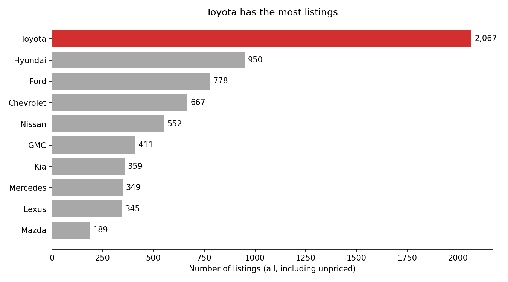
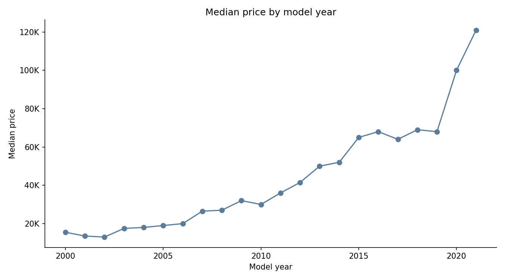
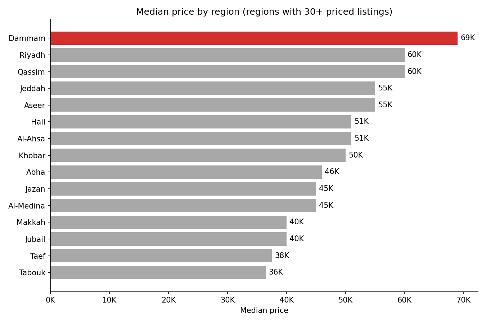

# Used Cars in Saudi Arabia: Data Cleaning and Market Report

A reproducible pipeline that cleans a raw used-car listings file and produces an Excel report with charts and summary tables.

## Overview
The raw data has 8,248 listings with missing prices, impossible mileage values and duplicate rows. This project documents each cleaning decision and generates a report with one command.

**Illustrative audience:** a car dealership manager who wants a summary of listings and median prices by make, model year and region.

## Tools
Python (pandas, matplotlib, openpyxl), Jupyter Notebook

## Data
Used cars listings dataset from Kaggle: [https://www.kaggle.com/datasets/turkibintalib/saudi-arabia-used-cars-dataset].
The `Link` column in the file points to syarah.com. The data file is not included in this repository; download it and place it next to `generate_report.py` as `UsedCarsSA_Unclean_EN.csv`. The collection date and the currency of the prices are not stated in the dataset.

## How to run
```
pip install -r requirements.txt
python generate_report.py
```
The report is regenerated by running one command on a new export with the same columns. It does not fetch data automatically.

Optional filters:
```
python generate_report.py --region Riyadh
python generate_report.py --make Toyota
python generate_report.py --make Kia --region Jeddah
python generate_report.py --interactive
```
Output goes to `output/` (filtered reports go to a subfolder, e.g. `output/region_Riyadh/`):
- `used_cars_report.xlsx`: Summary (charts), By Make, By Year, By Region, Notes
- Three PNG charts
- `used_cars_clean.csv`

A sample report is in [`sample_output/`](sample_output/).

## Cleaning decisions
| Step | Decision | Rows affected |
|---|---|---|
| Price | Text converted to number. Listings marked "Negotiable" have no stated price and are excluded from price analysis | 2,596 |
| Price | A price of 0 was excluded | 1 |
| Mileage | Values above 1,000,000 km treated as entry errors and set to missing | 45 |
| Mileage | For cars older than 5 years (relative to 2026) with mileage under 1,000 km, values were assumed to be entered in thousands of km and multiplied by 1,000. These rows are flagged in `Mileage_adjusted` | 913 |
| Duplicates | Rows identical across all columns, including the listing link, were removed. Listings with identical specs but different links were kept | 20 |
| Missing values | `Engine_Size` (2,263), `Options` (109), `Origin` (95) and `Gear_Type` (74) were left as missing and are not used in the report | none removed |

After cleaning: 8,228 listings, of which 5,635 (about 68%) have a stated price.

The thresholds (1,000,000 km, 1,000 km, 5 years, reference year 2026) are assumptions and can be changed at the top of `generate_report.py`.

## Key findings
- **Toyota has the most listings:** 2,067 of 8,228 (about 25%), followed by Hyundai (950) and Ford (778).
- **Median price differs widely by make:** among the 10 makes with the most listings, medians range from 36.5K (Nissan) to 145K (Mercedes).
- **Median price is higher for newer model years:** from 27K (2008) to 121K (2021). The 2020 and 2021 medians come from fewer priced listings (415 and 128), and 2022 listings have no stated price.
- **Median price by region:** among the 15 regions with at least 30 priced listings, medians range from 36.5K (Tabouk) to 69K (Dammam); Riyadh is 60K.

These are descriptive results. Differences between regions or years may reflect the mix of makes and do not show causes.

## Charts




## Limitations
- Price analysis uses only listings with a stated price (about 68%). Listings marked "Negotiable" may differ from priced ones in ways the data cannot show.
- Medians are used because expensive cars skew averages.
- The mileage correction is an assumption based on the pattern of values. Mileage is cleaned and kept in the output file but is not used in the report's charts.
- Regions with fewer than 30 priced listings are excluded from the regional chart because their medians are unstable.
- The model-year analysis starts at 2000.

## Project structure
```
├── README.md
├── generate_report.py
├── cars.ipynb            # exploration and cleaning steps
├── requirements.txt
├── .gitignore
└── sample_output/
```
